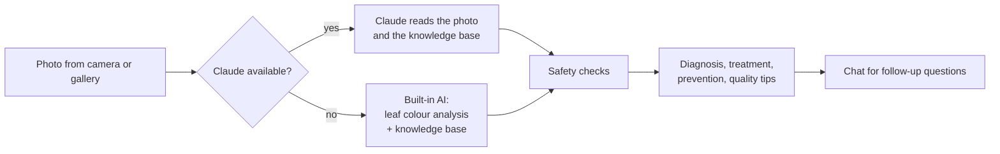

# 🌿 AgriVision

**Take a photo of a leaf, fruit or plant. AgriVision identifies the crop, detects the problem, and tells the farmer what to do about it.**
Built for farmers in Bihar and Jharkhand. Works in English and Hindi.

Live demo (render deployed): agrivisionapi.onrender.com

---

## The problem

Small farmers in Bihar and Jharkhand often find out about a crop disease only after it has spread. The nearest expert (a Krishi Vigyan Kendra, or KVK) may be far away, and guessing a spray can waste money, damage the crop and harm health.

## The solution

AgriVision puts a first-line crop doctor on the farmer's phone:

1. **Scan** a leaf or fruit with the camera, or choose a photo from the gallery.
2. **Detect** the crop and the disease, pest or deficiency, with a severity rating and a confidence score.
3. **Treat**: get clear steps to cure it, prevent it next season, and grow healthier, richer produce.
4. **Ask**: chat with the assistant for follow-up questions, in English or Hindi.

When the app is not sure, it says so and sends the farmer to the local KVK instead of guessing.

## Features

- Camera with a live light and sharpness meter, torch button, and gallery upload
- Automatic crop detection (no need to choose the crop first)
- Disease, pest and nutrient-deficiency diagnosis with severity and confidence
- Treatment, prevention and crop-quality advice from a vetted knowledge base
- Chat assistant for follow-up questions
- English and Hindi
- Safety checks on every answer (see below)
- Scan history, and "save report as PDF"
- Light and dark mode, built for phone screens
- Built-in AI fallback that works offline

## How it works



**Two AI engines, chosen automatically**

| Engine | Where it works | What it does |
|---|---|---|
| **Claude** (AI assistant) | When the page is opened from its claude.ai link | Reads the photo, identifies the crop, diagnoses the problem, and writes advice from the whole knowledge base. Powers the chat. |
| **Built-in AI** | Anywhere, including GitHub Pages and offline | Measures leaf colours (green, yellow, brown, white) and counts spots, then lists likely problems for the crop the user selects. Rule-based chat from the knowledge base. |

**Safety checks on every answer**

- Any chemical amount (for example "2 ml/l") is replaced with "use as per label, on KVK advice". The app never gives doses.
- It checks whether the crop and the cure match an entry in the knowledge base.
- Low confidence, an unknown crop or an unclear photo triggers a "show this to your KVK" warning.
- The "Agent activity and safety checks" panel shows these checks to the user.

## Crops covered

31 knowledge entries for crops common in Bihar and Jharkhand:

| Crop | Problems covered |
|---|---|
| Rice (paddy) | Blast, bacterial leaf blight, brown spot, sheath blight, zinc deficiency (khaira) |
| Wheat | Yellow rust, spot blotch |
| Maize | Fall armyworm, turcicum leaf blight |
| Lentil, chickpea | Wilt |
| Chickpea, arhar | Pod borer |
| Arhar (pigeonpea) | Sterility mosaic |
| Mustard | Aphid, Alternaria blight |
| Potato | Late blight, early blight |
| Tomato | Early blight |
| Tomato, chilli, okra, brinjal | Leaf curl and mosaic viruses |
| Brinjal | Shoot and fruit borer |
| Cabbage, cauliflower | Black rot, diamondback moth |
| Onion | Purple blotch |
| Mango | Anthracnose, powdery mildew |
| Litchi | Fruit cracking, fruit borer |
| Banana | Panama wilt, Sigatoka leaf spot |
| Guava | Wilt |
| Sugarcane | Red rot |
| All crops | Nitrogen deficiency, healthy plant |

## Project structure

```
agrivision/
├── docs/index.html        The whole site in one file. Deploy this.
├── src/
│   ├── index.src.html     Page source (edit this)
│   └── engine.js          Built-in AI source (edit this)
├── knowledge.json         The crop knowledge base
└── tools/build.py         Rebuilds docs/index.html from the files above
```

There is no server, no database and no API key.

## Deploy on GitHub Pages

1. Push this folder to a GitHub repository.
2. Go to **Settings → Pages**, choose the `main` branch and the `/docs` folder, and save.
3. Open the link GitHub gives you. This version runs the **built-in AI** (Claude is available only on the claude.ai link).

## Edit the knowledge base

Open `knowledge.json`. Each entry looks like this:

```json
{
  "c": ["rice", "paddy"],
  "k": ["blast"],
  "n": "Rice blast",
  "cure": ["Step to treat it", "Another step"],
  "prev": ["How to prevent it"],
  "q": ["Tip for better quality produce"]
}
```

| Field | Meaning |
|---|---|
| `c` | Crop names that this entry applies to (`"any"` for all crops) |
| `k` | Keywords that match the problem |
| `n` | Name of the problem |
| `cure` / `prev` / `q` | Treatment steps, prevention steps, quality tips |

After editing, rebuild the site:

```bash
python3 tools/build.py
```

Then commit `docs/index.html`. Have an agronomy teacher or your local KVK review any change before real farmers rely on it.

## Limitations (please read)

- **Not a lab test.** A photo gives a likely diagnosis, not a certain one. The app shows its confidence and asks the farmer to confirm with a KVK when unsure.
- **The built-in AI is simple.** It judges colour, not disease. It lists likely problems for the chosen crop and cannot tell which one it is. White walls, ripe fruit and poor light can fool it.
- **Claude needs its link.** Claude features need the page to be opened from its claude.ai link, where each viewer allows Claude on their own account. A scan can take up to a minute.
- **The knowledge base is small.** It covers 31 common problems, so rarer diseases return general advice and a KVK referral.
- **No chemical doses, by design.** The app only says "as per label, on KVK advice".
- **Accuracy is not yet measured.** Before presenting numbers, test with your own photos of each crop and report the real hit rate.

## Roadmap

- Train a plant-disease image model (for example on PlantVillage and PlantDoc plus local field photos) for accurate offline detection
- More crops, more diseases, and more languages (Bhojpuri, Maithili, Bengali)
- Voice input and spoken answers for farmers who prefer not to read
- Live weather and spray-timing alerts
- Nearby KVK finder and a "call my KVK" button
- Outbreak map from anonymous scans
- Scan history that syncs across devices

## Disclaimer

AgriVision gives general guidance and is not a replacement for a qualified agronomist. Always confirm diagnoses and follow the product label and local KVK advice before using any pesticide or fertiliser.
